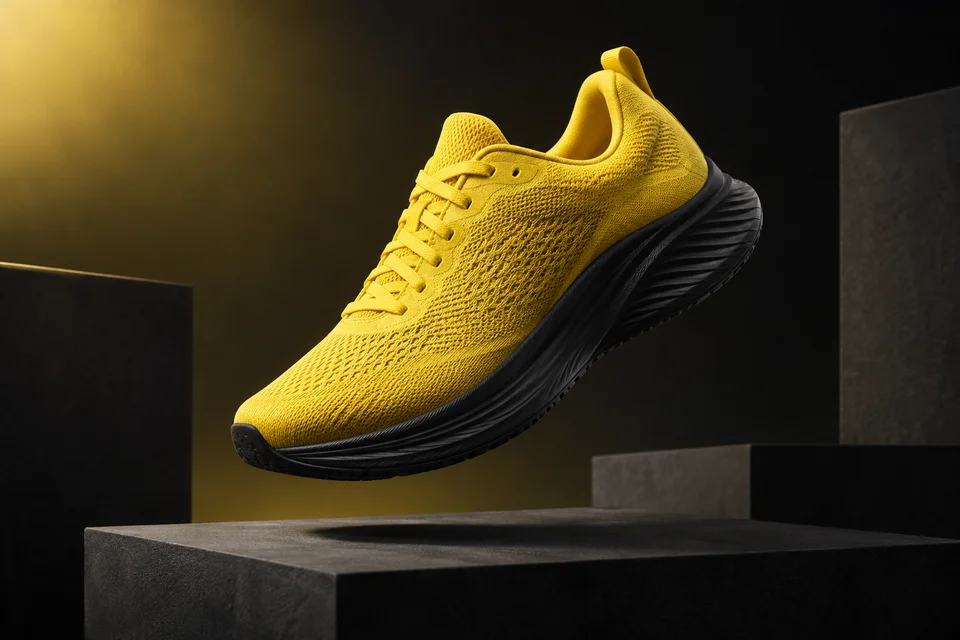
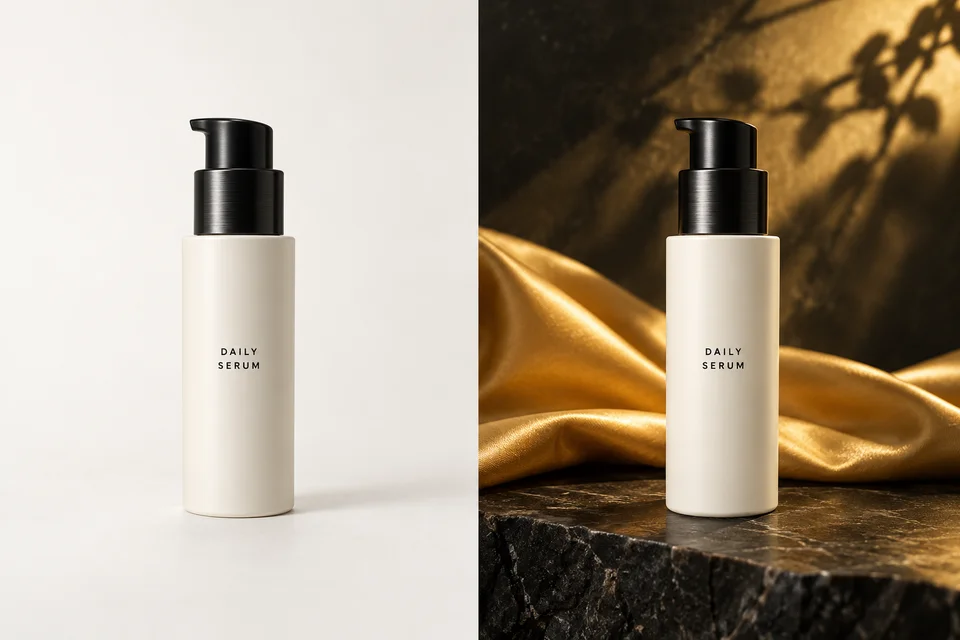
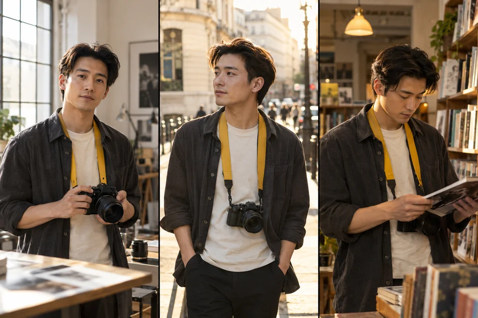
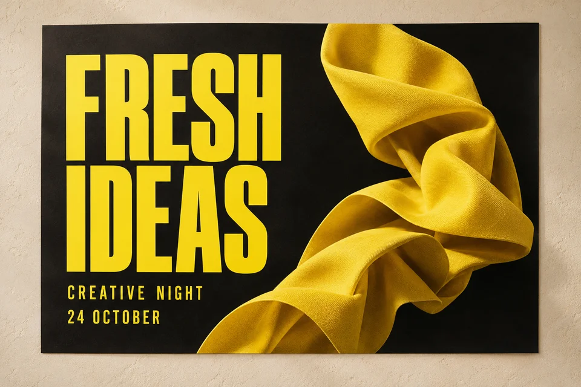

# Nano Banana image workflows

Practical prompt recipes and review checklists for image generation and reference editing.
This is the public documentation companion to [Nano Banana 2.1](https://nanobanana21pro.com/), an independent image-creation service. It is not an official Google, OpenAI, or model-provider project.

[中文说明](README.zh-CN.md) · [Start here](docs/getting-started.md) · [Example provenance](assets/PROVENANCE.json)

## What you can learn

| Task | Walkthrough | Example |
| --- | --- | --- |
| Create a product campaign | [Subject, lighting and composition](docs/product-images.md) | [Running-shoe campaign](examples/01-product-campaign/README.md) |
| Edit a reference image | [Preserve the object while changing the setting](docs/reference-editing.md) | [Serum source and scene](examples/02-reference-edit/README.md) |
| Keep a fictional character consistent | [Reuse one reference across scenes](docs/consistent-characters.md) | [Photographer storyboard](examples/03-character-scenes/README.md) |
| Put readable words in a poster | [Quote exact text and proofread](docs/readable-text.md) | [FRESH IDEAS poster](examples/04-exact-text/README.md) |
| Choose output settings | [Aspect ratio, resolution and credit review](docs/output-settings.md) | Settings are suggestions, not benchmark measurements |

## Original illustrative examples

These original AI-generated illustrations were created for the website with the built-in image generation tool. **They are not outputs from a verified website generation run, customer images, or model benchmarks.** Each recipe includes its asset-generation prompt, an adapted workflow prompt, and a manual review checklist. The manifest records provenance and file hashes; reproducing a prompt will not reproduce identical pixels.

## Use the recipes

1. Read [Getting started](docs/getting-started.md).
2. Copy an example's `workflow-prompt.txt` into your chosen image interface.
3. For edits, upload the **source-only** reference, not the completed comparison or contact sheet.
4. Choose a model that supports your operation. Review its current availability and credit quote before submitting.
5. Inspect the output at full size. Proofread text, compare reference details, and check edges and cropping.

The tutorials can be read without an account. Generating through the website requires signing in and sufficient credits; current prices and availability are shown in the interface. This repository does not run a backend, connect to a paid API, or contain API credentials.

## Limits and responsible use

- Text accuracy, character similarity, faithful product details and transparent edges are not guaranteed.
- Upload only references you have permission to use. Do not upload another person's private photos without consent.
- Fictional images are illustrative; do not pass them off as real products, people, events or scientific evidence.
- Confirm applicable provider terms and rights before publishing generated output.
- Do not put keys, account screenshots, customer uploads or billing data in a GitHub issue.

## Contents and contribution

This repository intentionally contains authored documentation, prompt text, simple example settings and selected illustrative assets and separately labeled operator-test outputs. The application and its business infrastructure are separate and are not open-sourced here.

Corrections and useful prompt refinements are welcome; see [CONTRIBUTING.md](CONTRIBUTING.md), [SECURITY.md](SECURITY.md) and [USAGE.md](USAGE.md). Avoid advertising-only submissions and unsupported performance claims.

## Evaluation criteria

Read the [evaluation method](docs/evaluation-method.md) for product preservation, Chinese text, fictional-character edits, background operations and multiple references. The 2026-10-13 operator test completed twenty requests at 150 site credits. Technical completion is separate from visual quality; person and shoe cutouts retained unwanted foreground objects.

## Recorded website outputs — 2026-10-13

20 submissions, 20 returned images, 150 site credits, no retries or retouching. These are operator tests, not independent reviews. Read the [case manifest](evidence/2026-10-13/results.json) for full prompts, inputs, endpoints, settings, dimensions, credit charges, timing definitions and limitations. Download every original PNG from that directory.

