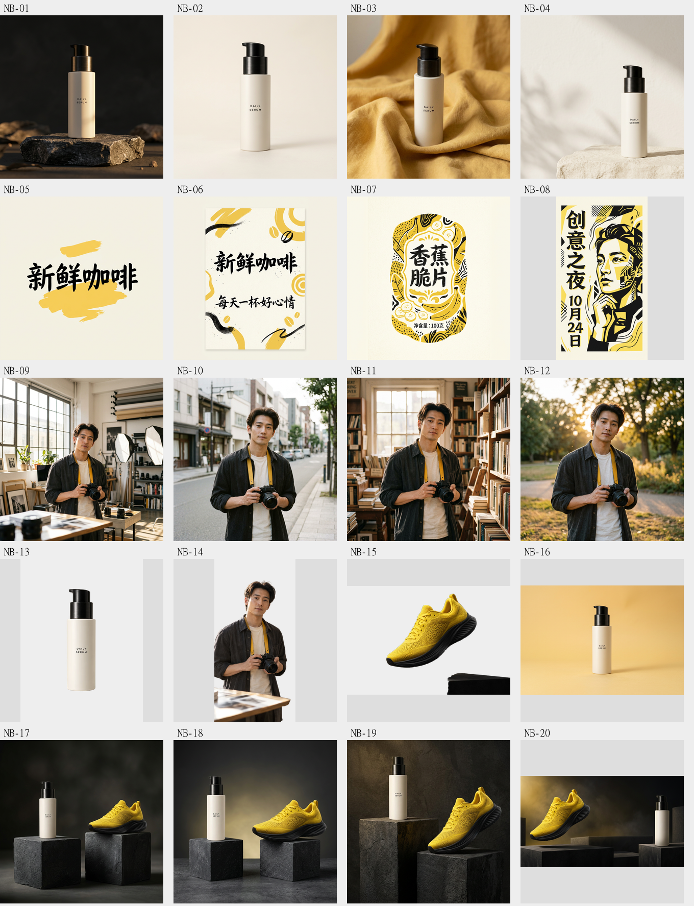

# Nano Banana 图片创作工作流

这是 [Nano Banana 2.1](https://nanobanana21pro.com/) 的公开教程与提示词配套仓库，帮助你制作商品场景、编辑参考图片、保持虚构人物一致，以及生成带准确文字的海报。

本站是独立服务，与 Google、OpenAI 或模型提供商没有官方隶属关系。此仓库不公开网站业务源码，不包含账号、密钥或客户图片。

## 学习路径

1. [开始使用](docs/getting-started.md)：选择任务、编写提示词、确认费用、检查结果。
2. [商品图片](docs/product-images.md)：安排主体、背景、光线和留白。
3. [参考图编辑](docs/reference-editing.md)：明确保留哪些细节，以及只修改哪些部分。
4. [人物一致性](docs/consistent-characters.md)：用同一张虚构人物参考图逐场景创作。
5. [准确文字](docs/readable-text.md)：用引号标记文字，逐字检查结果。
6. [输出设置](docs/output-settings.md)：检查比例、分辨率、数量和积分报价。

## 四个原创示例

| 场景 | 示例与提示词 |
| --- | --- |
| 黄色跑鞋商品广告 | [商品广告示例](examples/01-product-campaign/README.md) |
| 同一精华瓶更换布景 | [参考图编辑示例](examples/02-reference-edit/README.md) |
| 同一摄影师出现在三个场景 | [人物分镜示例](examples/03-character-scenes/README.md) |
| FRESH IDEAS 黑黄海报 | [准确文字示例](examples/04-exact-text/README.md) |

**示例图片由内置图片生成工具为网站原创生成，不是本站模型实测输出，也不是客户作品或效果保证。** 每个示例公开素材生成提示词、适合工作台使用的提示词和检查清单。[素材来源与哈希](assets/PROVENANCE.json) 可用于核对图片文件。

教程可以直接阅读。使用网站生图需要登录，并根据界面的实际报价消耗积分；模型可用性和收费以提交前显示的状态为准。阅读或复制本仓库内容不会触发付费请求。

编辑时使用示例中的单独原图，不要把左右对比图或三格分镜当作参考原图。生成后检查文字、人物、产品和裁切；不要把虚构素材当作真实事实或商品承诺。

欢迎通过 Issue 提出教程错误或通过 PR 改进提示词，参阅 [贡献说明](CONTRIBUTING.md)。请勿在公开内容中上传密钥、个人账号截图、支付记录或客户参考图。素材使用说明见 [USAGE.md](USAGE.md)。

## 真实网站输出 — 2026-10-13

20 次提交均返回图片，合计 150 网站积分，无重试或修图。这是运营者实测，不是独立评测，也不是视觉效果全部合格。人物与鞋子抠图仍留下桌面或底座。查看[完整清单](evidence/2026-10-13/results.json)及目录中的全部原始 PNG。

